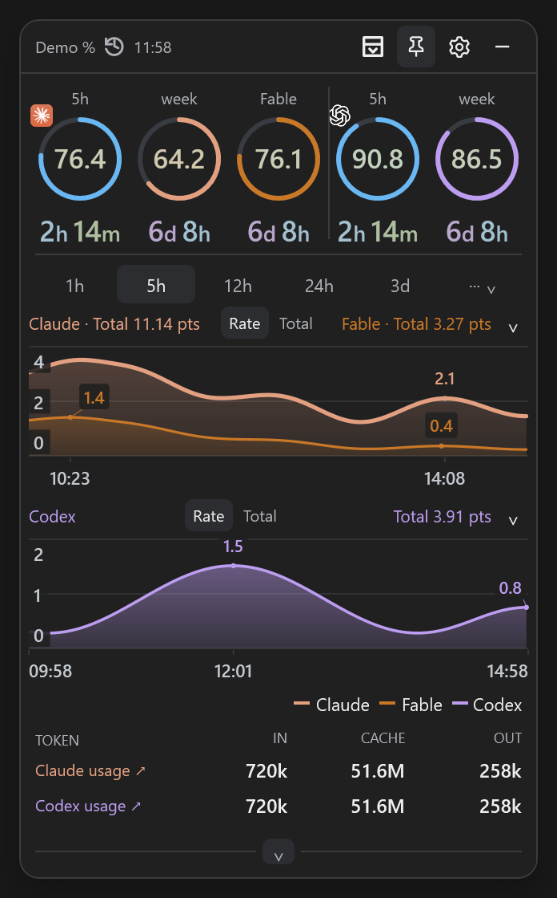
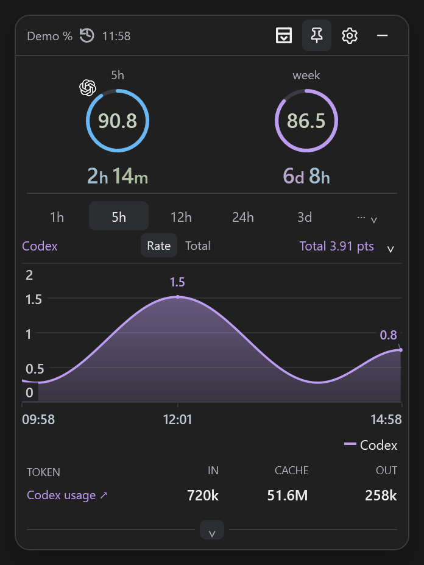
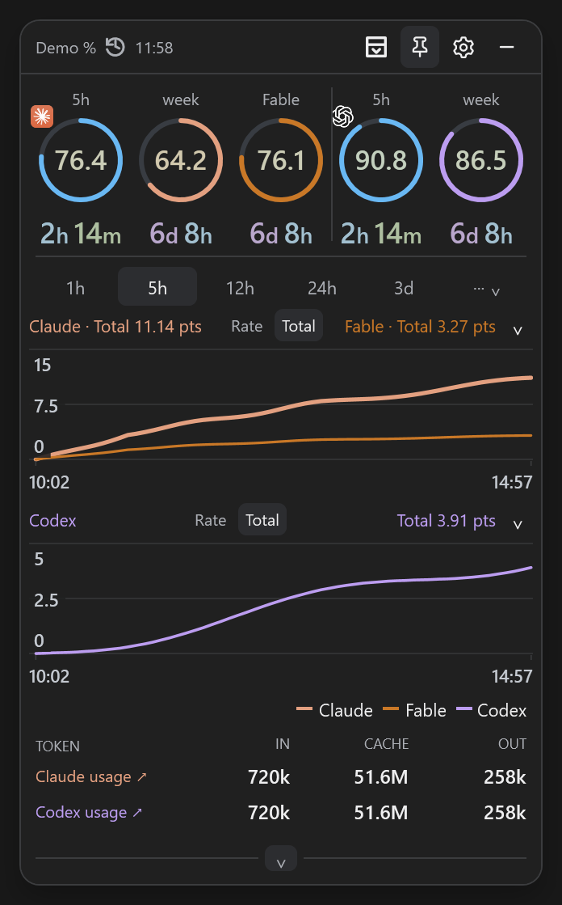
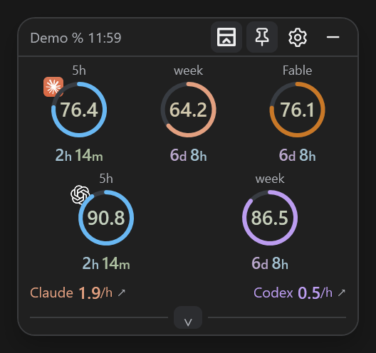
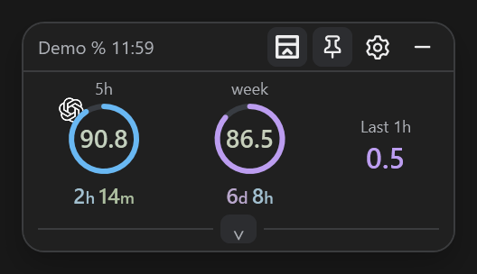
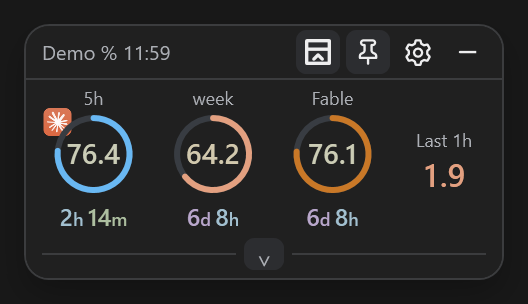
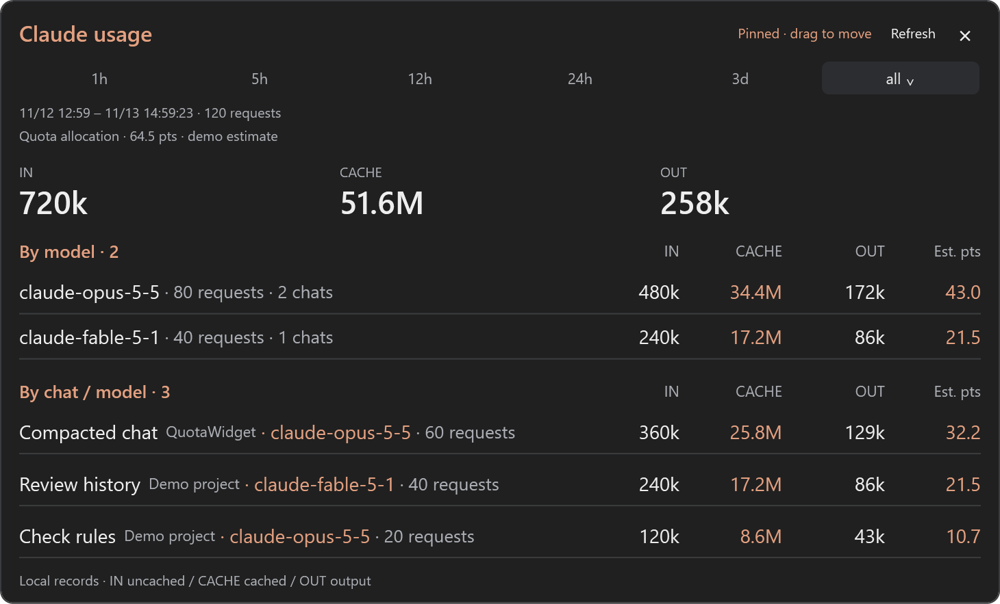
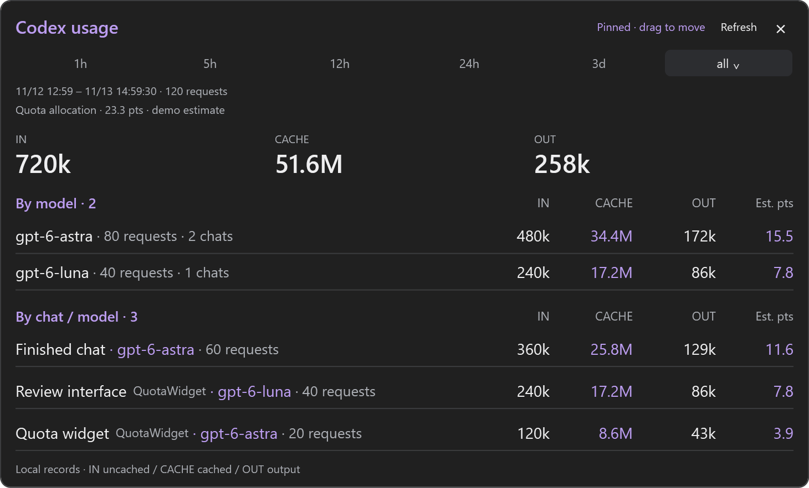
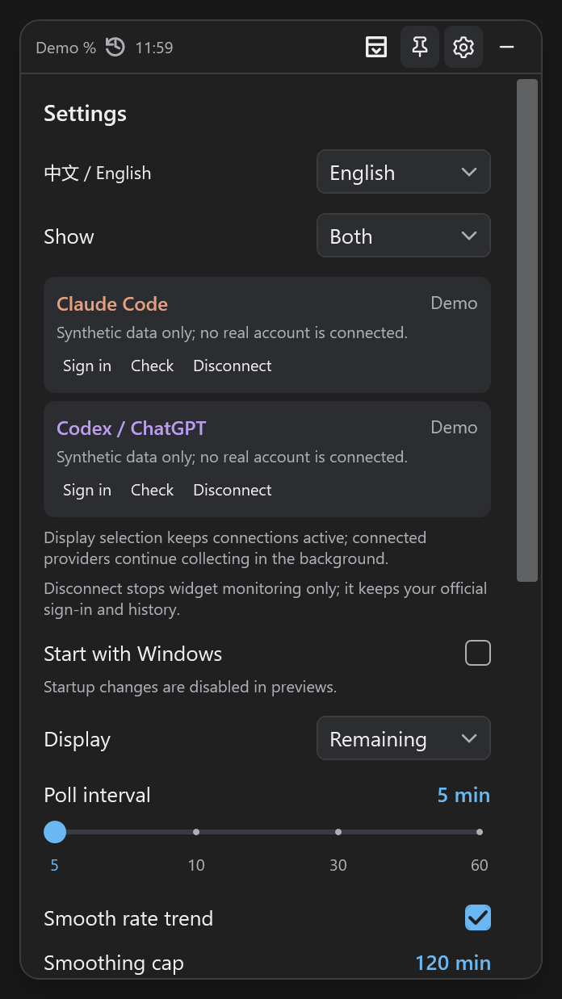

# QuotaWidget

**English** · [简体中文](README.zh-CN.md)

A small Windows desktop widget for Claude and Codex quota, usage trends, and local chat activity. See remaining quota and reset countdowns without reopening usage pages.

**[Download for Windows](https://github.com/HailiangLoo/QuotaWidget/releases/latest)** · [Privacy](docs/PRIVACY.md) · [Development & testing](CONTRIBUTING.md)

## Screenshots

All screenshots use synthetic demo data. Supports light and dark themes, full and compact modes, and Claude, Codex, or both. **Click any image to view it at full size.**

<table>
  <tr>
    <th width="33%">Claude + Codex · Full</th>
    <th width="33%">Codex · Full</th>
    <th width="33%">Cumulative view</th>
  </tr>
  <tr>
    <td align="center" valign="top"><a href="docs/images/both-expanded-en.png"></a></td>
    <td align="center" valign="top"><a href="docs/images/codex-expanded-en.png"></a></td>
    <td align="center" valign="top"><a href="docs/images/both-cumulative-en.png"></a></td>
  </tr>
  <tr>
    <th>Compact modes</th>
    <th>Usage details</th>
    <th>Settings</th>
  </tr>
  <tr>
    <td align="center" valign="top"><strong>Claude + Codex</strong><br /><a href="docs/images/both-compact-en.png"></a><br /><strong>Codex</strong><br /><a href="docs/images/codex-compact-en.png"></a><br /><strong>Claude</strong><br /><a href="docs/images/claude-compact-en.png"></a></td>
    <td align="center" valign="top"><strong>Claude</strong><br /><a href="docs/images/claude-usage-en.png"></a><br /><strong>Codex</strong><br /><a href="docs/images/codex-usage-en.png"></a></td>
    <td align="center" valign="top"><a href="docs/images/settings-en.png"></a></td>
  </tr>
</table>

Each chart chooses Rate or Total independently. The numbers in its header remain recorded totals.

### Local usage details

**To see which tasks account for your usage, click “Claude usage ↗ / Codex usage ↗” in the TOKEN section. In compact mode, click the value below “Last 1h” for a single provider, or the provider's usage ↗ when showing both.** Hover to preview; click the card to pin it. Subscription-only usage shows the observed recent-hour average in points/hour. When the last hour includes Codex credits, its summary shows recorded amounts instead: credits alone, or points + credits for mixed usage. Units stay separate; `*` marks incomplete or stale coverage. Credits are account-level net balance decreases and are not attributed to chats.

Each provider has its own movable detail window. Choose **1h / 5h / 12h / 24h / 3d + 1w / 1m / all**, then compare model totals and individual chat/model rows: input, cached-input and output tokens, plus validated quota estimates. Different models used within one chat get separate rows. Project names appear in smaller, muted text; confirmed subagent usage is grouped under its parent chat. The initial range follows the full view, or starts at 1h in compact mode; each window then selects its range independently. Drag content to move either window; controls and scrolling retain their usual actions.

Visible pinned windows automatically refresh at the configured polling interval (5 minutes by default), preserving their range and scroll position. This only reads existing local records; it does not trigger quota requests or model calls. Hidden or closed windows do not refresh, and dragging or recent interaction briefly defers an update. **Refresh** remains available for an immediate update.

The **Est. pts** column apportions observed weekly quota using locally calibrated model/input/cache/output weights. It appears only after held-out validation and allocation-stability checks; insufficient or conflicting data shows a dash. This assumes the quota consumption is represented in local logs. It is an estimate, not a provider bill. All names, projects and numbers shown here are synthetic.

### Settings

The gear is available in full and compact modes. Settings includes language, provider connections, display units, polling, smoothing, chat cache reminders and local token tracking. Smoothing caps are **60, 90, 120 (default), and 150 minutes**. The estimator adapts below that cap, so choosing 150 does not force every curve to use a 150-minute window. This preference affects the rate curve, not recorded cumulative points or the observed one-hour average.

**Link idle gaps** defaults to **10 minutes**, with Off, 5, 10 and 15-minute choices. Faint dashed links connect confirmed short pauses in the smoothed chart, without shading or counting idle usage. Hover shows “Idle · visual link.” Missing samples, resets and known model changes remain separate; chat statistics are unchanged.

Polling, smoothing and idle-gap settings use sliders with labelled stops. Click or drag to snap to a value; dragging previews it and release saves it. Arrow keys also move between stops.

## Features

- Claude: five-hour, total weekly, and Fable weekly quota.
- Codex: weekly quota, plus a five-hour gauge when the account's interface provides it.
- **Credits:** remaining balance and recorded net use. A pale violet dashed line uses the Codex chart's right axis: `cr/h` in rate mode, `cr` in cumulative mode. No conversion to subscription quota. Recording begins with this version; `*` marks incomplete coverage or a stale balance. See [limitations](docs/ALGORITHM.md#credits).
- Independent rate or cumulative views for each provider, with 1h, 5h, 12h, 24h, 3d, and all-history ranges.
- Codex timers stay green; idle chats fold after two hours, while running tasks remain visible. Claude keeps its existing reminder rules. Folded rows remain for 24 hours and history is retained. The menu after `3d` is shared with usage details; `1m` means a rolling 30 days.
- Main-chat activity and cache reminders; identified subagents stay out of the management list, while their usage remains in statistics and is grouped under a parent when confirmed.
- Expanded chat lists have their own scrollbar, keeping the meters and charts in place. Both layouts share the same order: elapsed time as a fraction of each chat's reminder window, with running chats below idle ones. Reordering happens at most once a minute and pauses during interaction; switching layouts preserves the order and cooldown.
- Always on top, system tray, compact mode, and layouts that adapt to narrow windows.
- Resize from any corner or edge: corners adjust width and height independently, sides adjust one dimension. Text keeps its size and charts stay visible. Full mode remembers its dimensions; compact mode remembers its width and fits its height to the last visible item, including after a resize or a chat-list update. Long compact lists scroll within the screen. Resize handles have no visible icons.
- English and Simplified Chinese, with an instant language switch in Settings.

## Getting started

1. Download `QuotaWidget-v<version>-win-x64.exe` from [Releases](https://github.com/HailiangLoo/QuotaWidget/releases/latest) and keep it in a folder of your choice. Choose the app EXE, not GitHub's source-code archive. Older releases such as v0.13.9 use a ZIP: extract those once and open the EXE inside.
2. Double-click the EXE. It contains the .NET runtime; no installer, extraction step, helper scripts, or separate runtime download is needed for the single-file release.
3. On first launch, choose the providers to connect and complete official sign-in, then select **Start monitoring**. Only those providers are enabled, and no quota collection or chat-log reading begins before this step. The gear remains available in compact mode.
4. **Show** selects Claude, Codex, or both for the visible widget. It does not change connections: connected providers keep collecting in the background. Each provider has separate **Sign in**, **Check**, and **Connect / Disconnect** controls. Disconnect stops that provider's quota and local-log monitoring; it does not sign out of the official app or delete history. Sign-in opens the existing official login/app; the widget has no app-install action.
5. Choose a language in Settings. Language defaults to the Windows display language: Chinese on Chinese systems, English otherwise. You can choose **English** or **简体中文** explicitly.

**Codex:** install and sign in to the official Codex Windows app first. The widget checks the signature of the bundled CLI, queries quota through it, and reuses the existing sign-in.

Official installation and sign-in guides: [Codex / ChatGPT](https://learn.chatgpt.com/docs/app), [ChatGPT authentication](https://learn.chatgpt.com/docs/auth), and [Claude Code](https://code.claude.com/docs/en/setup).

**Claude:** requires a supported official Claude Code CLI, or the CLI bundled with the Claude Windows app. Use **Settings > Claude Code > Sign in** to complete the widget's separate sign-in. If no compatible CLI is found, update the official app or set `claudeExePath` in `settings.json`.

To preview the widget without an account, choose **Preview demo** in Settings. Demo data is stored separately from real data. Licenses for the app and its bundled runtime are also available in Settings.

Requires Windows 10/11, x64. Release binaries are currently unsigned.

### Updating

There is no automatic updater. When you want a newer version, download its EXE, quit the widget from the tray, replace your old EXE, and reopen it. Keep the same filename if you use a shortcut. Settings and history stay in your user data directory and survive replacement. When moving from an older ZIP release, you can keep the new EXE in a new folder and retire the old extracted folder after verifying it works; do not delete the data directory.

## Data and accuracy

Data stays under `%USERPROFILE%\.quotawidget\data` for the current Windows user. It is not uploaded to GitHub with the application. Use `--data-dir "your-directory"` to choose a different location. Enable **Start with Windows** in Settings to show the widget when you sign in; turn it off there to remove the startup entry. This is opt-in, needs no administrator access and keeps the current data directory. Keep the EXE in the same location; if you move it, turn the option off and on again from the new location.

Official quota readings are the source of truth. **Rates estimate a trend from discrete quota readings and local activity.** Totals use valid raw readings; gaps are not invented or filled with zero. Activity on other devices or the web may be absent from local logs. Token totals are not an account bill and are not converted into precise per-chat weekly quota costs.

See [How smoothing works and its accuracy limits](docs/ALGORITHM.md). Smoothing estimates timing; it cannot reveal an exact instantaneous consumption rate. Fable-only fragments can share a rate stroke. Cumulative views share a stroke only when the entire selected recorded range is confirmed Fable-only; mixed history retains both complete curves. Header totals remain independent.

The two providers use different quota units and cannot be added together. Fable conversion is enabled only for recognized supported plans. Provider interfaces, plans, and quota windows can change; a missing window is never presented as zero usage.

See [Privacy](docs/PRIVACY.md) for the data access details. Use demo screenshots or redacted information in bug reports; do not upload your entire data directory.

## Build from source

Install the .NET 10 SDK on Windows, then run:

```powershell
dotnet run --project tests/QuotaWidget.Tests -c Release
dotnet run --project tests/QuotaWidget.UiTests -c Release
pwsh -File scripts/Build-Release.ps1
```

The build script requires PowerShell 7 and writes one EXE plus an optional SHA-256 checksum to `artifacts/`. For a version ending in `-local`, add `-AllowPrerelease`. Tests do not require a signed-in account by default. Checks that use installed official CLIs are opt-in; see [CONTRIBUTING.md](CONTRIBUTING.md).

For an English demo, run `QuotaWidget.exe --demo --language en`. Use `--language zh-CN` for Chinese or `--language auto` to follow Windows.

## License

Source code and original artwork are licensed under [MIT](LICENSE). This is an independent project, not an official Anthropic or OpenAI product, and is not endorsed by either company. The app icon includes provider identification marks; those names and logos belong to their respective owners and are not covered by MIT. See [NOTICE](NOTICE.md) for runtime and trademark details.
